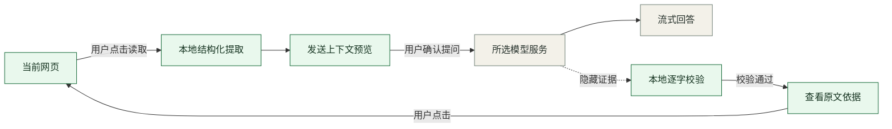

<div align="center">

<p><code>LOCAL-FIRST · BYOK · TRACEABLE</code></p>

# ReadAside

### 不离开当前网页，边读、边问、边核对。

ReadAside 是一个 Chrome 网页阅读侧栏。它在本地提取页面结构，<br />
让你在发送前看清 AI 将读到什么，在回答后回到真正支撑结论的原句。

<p>
  
  
  
  <a href="./LICENSE"></a>
</p>

<p>
  <a href="#-快速开始">快速开始</a> ·
  <a href="#-核心体验">核心体验</a> ·
  <a href="#原文依据如何工作">原文依据</a> ·
  <a href="#-数据边界">数据边界</a> ·
  <a href="#-开发与验证">开发与验证</a>
</p>

</div>

<p align="center">
  
</p>

<div align="center">

**READ THE PAGE&nbsp;&nbsp;→&nbsp;&nbsp;ASK IN CONTEXT&nbsp;&nbsp;→&nbsp;&nbsp;VERIFY THE SOURCE**

</div>

> [!IMPORTANT]
> ReadAside 目前处于 beta。通过 Chrome 开发者模式安装，使用你自己的模型 API Key；项目没有自建服务器、账号系统或遥测。

## 为什么是 ReadAside

网页阅读真正麻烦的，不只是“让 AI 总结一下”。

把内容复制到另一个聊天窗口会切断阅读现场；长页面经过截断后，你又很难判断模型究竟看到了什么。即使答案看起来合理，也缺少一条快速回到原文、亲自核对的路径。

ReadAside 把这条链路收进当前标签页：

| 01 / READ | 02 / ASK | 03 / VERIFY |
| :--- | :--- | :--- |
| **按需读取**当前页面或选区 | **预览上下文**后再发送问题 | **点击定位**支撑回答的核心原句 |
| 保留标题、正文、列表、表格与代码结构 | 短页完整发送，长页本地选择相关块 | 隐藏证据协议，不污染回答正文 |

## ✦ 核心体验

### 留在阅读现场

侧栏与网页并排存在。读取、提问、追问和核对不再需要来回复制粘贴；切换问题时，页面仍停留在你的阅读现场。

### 看清模型读到了什么

发送前的预览直接展示本次采用的内容块、字符数和相对全文的缩减比例。你可以使用“自动选择”，也可以切换到“结合全文”做兼容或排查。

### 回到答案所依据的原句

回答正文保持干净，不出现内部块号或大段证据卡片。只有 AI 返回的原句通过本地逐字校验后，界面才显示 **查看原文依据**；点击按钮，网页才会滚动并临时高亮。

### 保持清楚的数据边界

页面结构解析、长页选择、证据校验和定位都发生在浏览器本地。只有发起提问时，必要上下文才会直连你选定的模型服务。

## ⚡ 快速开始

### 1. 安装扩展

当前版本需要通过 Chrome 开发者模式加载：

1. [下载源码](https://github.com/Gongyl01/readaside/archive/refs/heads/main.zip)并解压，或克隆本仓库。
2. 在 Chrome 地址栏打开 `chrome://extensions`。
3. 开启右上角的 **开发者模式**，点击 **加载已解压的扩展程序**。
4. 选择包含 `manifest.json` 的 ReadAside 目录。
5. 打开 ReadAside 侧栏，在设置中选择服务地址、填写模型名和个人 API Key，保存后测试连接。

设置支持 DeepSeek、OpenAI、Anthropic 预设地址，以及自定义 Base URL。自定义地址需选择 OpenAI Chat Completions 或 Anthropic Messages 兼容协议；模型名始终手动填写，以便服务商更新模型时直接修改。更换服务地址时须重新输入该地址的 API Key。测试连接只请求模型列表；列表未包含模型名或服务未提供列表接口时，以实际发送结果为准。DeepSeek 保留联网搜索和原文依据；其他 Anthropic 兼容服务可通过工具调用返回原文依据，OpenAI 兼容接口提供基本对话。

仓库已经提交构建后的 `dist/`，直接加载源码即可使用，不需要先安装 Node.js。

### 2. 开始阅读

1. 打开一个普通网页，点击 **读取当前页**。
2. 展开 **读取内容预览与诊断**，确认正文和结构化内容块。
3. 输入问题，在 **本次发送预览** 中确认 AI 将看到的范围。
4. 发送并继续追问；回答出现 **查看原文依据** 时，点击即可回到原句。

只需要解释一段内容时，可先在网页中选中文字，再点击 **读取选中文字**。输入框使用 <kbd>Shift</kbd> + <kbd>Enter</kbd> 换行。

## ⌁ 系统工作流



ReadAside 不会在后台持续抓取网页，也不会在回答完成后自动移动页面。读取和定位都由明确的用户操作触发。

## ◉ 0.11.1：模型配置与页面阅读修复

- API 设置支持 DeepSeek、OpenAI、Anthropic 和自定义服务地址；模型名由用户填写，并支持 OpenAI Chat Completions 与 Anthropic Messages 兼容协议。
- 修复部分网页中翻译插件样式被当作正文提取的问题。
- 自动选择会区分整页概览与指定主题，覆盖同类章节和多个独立问题；无关键词命中时回退到已提取的全文。
- 用户指出遗漏时，要求模型重新核对本次发送的页面内容。

## ◉ 0.11.0：从回答回到原文

这个版本建立了完整的隐藏证据闭环：

- AI 的可见回答与证据数据分离，内部块号不会出现在回答中。
- 同一次请求最多返回 3 条核心原句；正文取关键句，列表取相关项，表格取相关单元格或行。
- 本地只接受本次实际发送过的块，以及其中逐字存在且能够唯一匹配的原文。
- 伪造、改写、空内容和重复歧义证据都会被拒绝，不生成定位按钮。
- 多条有效依据可以依次查看，每次只高亮真正相关的最小文本范围。
- 优先使用采集时保留的结构路径；路径失效后，才尝试唯一原文与上下文恢复。

### 原文依据如何工作

```text
可见通道    清洁的自然语言回答
隐藏通道    blockId + exactQuote + supports
本地闸门    已发送块白名单 → 逐字存在 → 唯一匹配
页面动作    用户点击 → 滚动到原句 → 临时高亮 5 秒
```

> [!NOTE]
> “本次发送预览”回答的是 **模型看到了什么**；“查看原文依据”表示 **模型返回了能够被本地安全定位的核心原句**。模型没有返回证据，或证据未通过校验时，回答仍会正常显示，但不会出现按钮。

“结合全文”发送的是无块号兼容文本，因此不提供原文定位。DeepSeek Web Search 的外部来源继续使用普通链接或数字脚注，也不参与当前网页高亮。

## ▦ 页面理解与上下文

<details open>
<summary><strong>结构化读取</strong></summary>

- 合并顶层页面、可访问 iframe 和开放式 Shadow DOM 中的可见文字。
- 识别标题、正文、列表、表格、代码和引用，并保留标题路径、文档层来源与本地定位线索。
- 根据 DOM 与 ARIA 结构排除导航、分页器和工具栏列表，不依赖网站文案黑名单。
- 保留原生 HTML 表格的表头、行和单元格边界；合法 Markdown 管道表格也能恢复为表格预览。
- 支持读取网页选区，以及 Chrome 打开的 HTML、TXT、JSON 和 Markdown 本地文件。

</details>

<details>
<summary><strong>上下文控制</strong></summary>

- 自动模式支持按位置选取 arXiv HTML 论文的引言或摘要段落。其他问题在页面不超过 16,000 字符时发送全部结构化内容块。
- 更长页面根据当前问题，在本地选择相关内容块并展示缩减比例。
- 选区问题优先使用选区，同时保留必要的整页上下文。
- 完整兼容文本、结构化内容块和实际发送内容分层展示，诊断信息不会混入模型上下文。

</details>

<details>
<summary><strong>回答与异常处理</strong></summary>

- 支持流式回答、GFM、表格、脚注、代码和 KaTeX 公式；DeepSeek 接口还支持按需联网搜索。
- 中文输入法组合输入期间，<kbd>Enter</kbd> 只确认候选词，不会误发送。
- API Key、余额、限流、网络、服务端和空回答具有不同提示。
- 失败的付费模型请求不会自动重试，需要用户确认后重新发送。

</details>

## ◇ 可重复评测

仓库包含固定数据集、版本快照与确定性门禁，用于区分“上下文选得对不对”和“证据放行是否安全”。

| SIGNAL | 0.11.1 RESULT |
| :--- | ---: |
| 短页面完整结构化发送 | **30 / 30** |
| 长页面必需证据召回 | **100% · 32 / 32** |
| 长页面上下文缩减中位数 | **85%** |
| 隐藏证据协议评测 | **8 / 8** |
| 无效或歧义证据错误放行 | **0** |

这些数字衡量本地上下文选择器与证据校验器，不等同于模型回答准确率、工具调用覆盖率或真实网页定位成功率。评测方法、历史快照与人工验收模板见 [docs/evaluation](./docs/evaluation/README.md)。

## ⛨ 数据边界

| 留在浏览器本地 | 提问时发送给所选模型服务 |
| :--- | :--- |
| DOM 路径与定位锚点 | 当前页面标题与 URL |
| 页面结构解析与长页选择 | 本次采用的页面上下文与选区 |
| 证据逐字校验与页面高亮 | 当前问题与最近 12 条对话消息 |
| 当前侧栏会话状态 | Anthropic 兼容请求的隐藏证据工具定义与允许使用的内容块号 |

- API Key 和接口设置仅保存在本机 `chrome.storage.local`，但这里不是系统钥匙串。
- 对话只保存在当前侧栏内存中，最多 20 轮；关闭侧栏或清除对话后释放，API Key 单独保留。
- 使用 DeepSeek Web Search 时，问题与相关上下文会被用于完成搜索。
- 项目没有自建服务器、用户账号、云同步、遥测或分析服务。

完整边界见 [PRIVACY.md](./PRIVACY.md)。不要在 Issue、截图或日志中提交 API Key、私密网页内容或 Chrome 配置目录。

### 读取本地文件

在扩展详情页开启 **允许访问文件网址**，再用 Chrome 打开 `.html`、`.htm`、`.txt`、`.json`、`.md` 或 `.markdown` 文件。本地文件内容在提问时同样会发送给所选模型服务，请勿读取不希望上传的敏感资料。

## 边界与限制

- 切换标签页后，需要重新点击“读取当前页”。
- Chrome 内置页面和 Chrome Web Store 受浏览器限制，无法读取。
- 关闭式 Shadow DOM、Canvas 文字和虚拟列表中尚未渲染的内容无法完整提取。
- 当前不支持 PDF、图片、视频、Canvas OCR 或完整虚拟列表采集。
- 当前不做用户登录、云同步、自建代理、自动操作网页或后台常驻抓取。
- 真实模型工具调用覆盖率和公开网页定位成功率仍需继续进行人工评测。

## ⌘ 开发与验证

需要 Node.js 20 或更高版本：

```bash
npm ci
npm run build
npm run verify
```

单独运行评测：

```bash
npm run evaluate:context:compare
npm run evaluate:context:gate
npm run evaluate:citations
npm run evaluate:evidence
```

生成本地安装包：

```bash
npm run package
```

产物位于 `release/readaside-0.11.1.zip`，不会包含 `node_modules`、测试文件、环境文件或本机配置。

<details>
<summary><strong>仓库结构</strong></summary>

```text
background.mjs        # API 设置、模型请求、流式事件
sidepanel.*           # 侧栏界面、会话状态与点击定位
lib/                  # 页面提取、上下文、证据和渲染逻辑
dist/                 # Markdown 渲染器与 KaTeX 字体
test/                 # 单元测试、评测数据与视觉验收页
scripts/              # 仓库检查、评测和发布打包
docs/                 # 架构、路线图、截图与评测报告
```

</details>

## 文档地图

| DOCUMENT | PURPOSE |
| :--- | :--- |
| [Architecture](./docs/ARCHITECTURE.md) | 扩展架构、协议、权限边界与数据流 |
| [Traceable Context Roadmap](./docs/TRACEABLE_CONTEXT_ENGINE_ROADMAP.md) | 可追溯上下文引擎路线图 |
| [Development Plan](./DEVELOPMENT_PLAN.md) | 当前状态与滚动开发计划 |
| [Evaluation](./docs/evaluation/README.md) | 数据集、指标、快照和人工验收 |
| [Changelog](./CHANGELOG.md) | 版本变化 |
| [Privacy](./PRIVACY.md) | 数据处理与隐私说明 |
| [Security](./SECURITY.md) | 安全边界与漏洞报告方式 |

## 参与项目

提交前请阅读 [CONTRIBUTING.md](./CONTRIBUTING.md) 与 [SECURITY.md](./SECURITY.md)，运行 `npm run verify`，并确认没有提交 API Key、私密网页内容或仅适用于个人机器的路径。

<div align="center">

**Read beside the page. Verify inside the page.**

ReadAside is released under the [MIT License](./LICENSE).<br />
Third-party notices are available in [THIRD_PARTY_NOTICES.md](./THIRD_PARTY_NOTICES.md).

</div>
